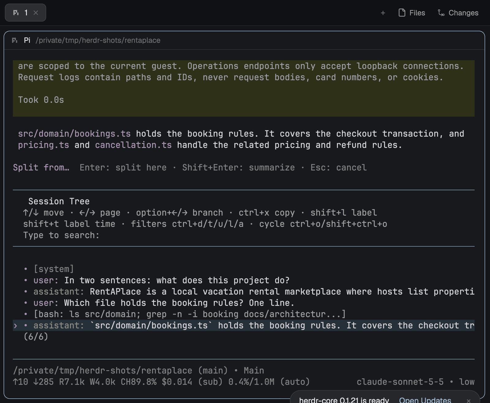
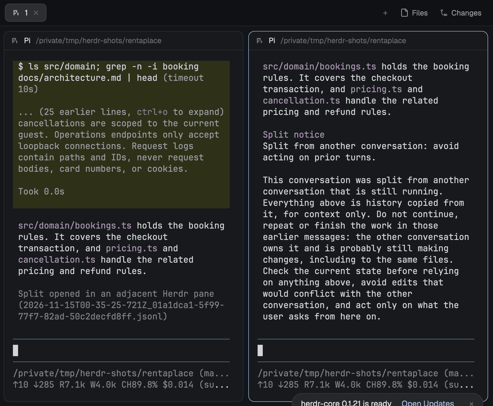

# Herdr Pi Split

`/split` branches a [Pi](https://pi.dev/) conversation into a new pane of the [Herdr](https://herdr.dev/) workspace. The new pane has the same history up to the message you pick. Main is not changed.

This is John Lindquist's own `/split` from MEGA.dev S04E01, "Splitting Conversations, the Lab, and Your First Agents". The lesson teaches you to build your own for the harness and workspace you use. This repository is the finished Pi and Herdr version, kept in step with the video so you can compare.

## Requirements

| You need | Why | Without it |
|---|---|---|
| [Pi](https://github.com/earendil-works/pi) 1.4 or newer (checked on 1.5.0; unit tests also pass on 1.5.2) | `/split` is a Pi extension | It cannot be installed |
| Pi running in a pane of the [Herdr](https://github.com/herdrdev/herdr-app) desktop app | Herdr opens the new pane | `/split` prints: "/split needs Pi running in a pane of the Herdr app, and this terminal is not one." Nothing else happens |
| Herdr's command-line tools `hc` and `herdr-app` on your `PATH` | `/split` asks Herdr for the pane through them | `/split` prints: "hc was not found on your PATH…" and no pane is split |
| `git` | `pi install` clones this repository | The install fails |
| macOS | The only system this was checked on | Unverified |

`/split --help`, the examples and the hints work in any terminal, also outside Herdr.

## Install

```sh
pi install git:github.com/johnlindquist/herdr-pi-split
```

Then run `/reload` in Pi, or start Pi again. The install has no dependencies to download.

- Update: `pi update --extensions`
- A fixed version: `pi install git:github.com/johnlindquist/herdr-pi-split@v0.4.0`
- Try once without installing: `pi -e git:github.com/johnlindquist/herdr-pi-split`
- Remove: `pi remove git:github.com/johnlindquist/herdr-pi-split`

## Walkthrough, in the video's order

Do these in Main, the Pi conversation you are working in. The pictures are real captures of a second Herdr window running Pi in a fresh clone of [RentAPlace](https://github.com/johnlindquist/rentaplace), with this extension installed from GitHub. The model's wording will differ on your machine.

1. **Type `/split`.** Dim text appears after the cursor: `["name"] [handoff focus]`. Both parts are optional. The dim text is a hint; it never becomes part of the command.

   ![Main with /split typed: dim text after the cursor reads ["name"] [handoff focus], then Space: examples and Enter: pick a message](docs/screenshots/split-hint.png)

   The hint also tells you the two keys that matter next: **Space** for examples, **Enter** to pick a message.
2. **Type a space.** A menu of examples opens. **↑/↓** moves, **Tab** inserts the example so you can edit it.
3. **Type a name in quotes**, for example `/split "Calendar idea" `. The hint now shows what is left: `[handoff focus]`.
4. **Run `/split --help`.** The whole guide prints in Main. No pane opens and the model is not called. It starts:

   ```
   Split a conversation into a new Herdr pane
   …
   /split — pick a message, copy history through it
   /split "Test fixes" — name the new session
   …
   /split --help — show this guide
   ```

5. **After you build or install it, run `/reload`**, then **run `/split`** and press **Enter**. The message search opens in the same pane, right where you ran `/split`. Type to filter the messages, for example `minimum`. The filter keys are listed at the top of the search; **ctrl+u** shows only your own messages.

   

   The search replaces the input of the pane you are in; no other pane opens yet. Every message of the conversation is a row, tool calls included, and the highlighted row is where the copy will stop. **Enter** copies the history up to that row. **Shift+Enter** starts the new pane from a short summary instead.
6. **Press Enter on a message.** A new pane opens to the right with the conversation up to that message. Ask it anything.

   

   Left is Main: one dim line says the split opened, and nothing else changed. Right is the new conversation: the copied history, then the **Split notice** that tells its agent the earlier work belongs to the other conversation.

### What you should see

- Main shows one line such as `Split "…" opened in an adjacent Herdr pane`. Main gets no new message and no extra turn. Its session file is not written to.
- The new pane shows the copied messages and ends with **Split notice**: the conversation was split from another one that is still running, so the agent must not continue the earlier work, must expect the other conversation to be changing files, and must act only on what you ask next.
- While the split is being named, the new pane shows a short progress screen first.

## More than the video shows

| Type | What happens |
|---|---|
| `/split "Test fixes"` | Names the split. Without a name, it is titled from your latest request. |
| `/split Investigate the failing tests` | Unquoted text is a handoff focus. The split starts from a short summary for that focus, written by your current model. The full history stays in its session tree. |
| `/split "Test fixes" Investigate the failing tests` | Name and focus together. |
| **Shift+Enter** in the search | Split there and ask for a handoff focus. |
| **ctrl+shift+alt+f** | Shortcut for `/split`. |

Set `HERDR_SPLIT_LAUNCHER` to start a different command than `pi` in the new pane.

The older terminal version of Herdr (the `herdr` command, where panes have `HERDR_PANE_ID`) is supported too: there `/split` uses `herdr pane split` instead of `hc` and `herdr-app`.

## Troubleshooting

- **"/split needs Pi running in a pane of the Herdr app…"** Pi was started in another terminal. Start it from a Herdr pane.
- **"hc was not found on your PATH…"** (or `herdr-app`). Herdr's command-line tools are not installed or not on the `PATH` Pi was started with.
- **"No unique Herdr app pane for terminal…"** `/split` could not tell which pane runs this Pi, so it split nothing instead of guessing.
- **The new pane stops at "Trust project folder?"** Pi asks this for a folder it has not seen. Answer it once with **Trust** and later splits open straight away.
- **A split failed after you chose the message.** The message in Main names the saved session and the `pi --session …` command that opens it.
- **`/split` is not in the menu after install.** Run `/reload`. `pi list` should show this repository.

## How it is built

| File | What it holds |
|---|---|
| `index.ts` | The extension. Registers `/split` and the shortcut, opens the message search (Pi's own tree selector), copies the conversation into a new session file, adds the notice, and starts the pane. |
| `guidance.ts` | Everything that explains the command: the hint text, the examples menu and the `--help` guide. |
| `app-pane.ts` | The Herdr side: finds the pane that runs this Pi (`hc get`, `herdr-app ls`) and asks Herdr to split it (`herdr-app do pane.split`). |
| `notice.md` | The words of the split notice. Edit this file to change them. |
| `handoff.md`, `title.md` | The prompts for the handoff summary and for naming a split. |
| `progress-pane.mjs` | The small progress screen shown in the new pane while a summary or name is written. |
| `test/` | Unit tests. |

How one split runs:

1. **Find the pane.** `/split` works out which Herdr pane runs this Pi. If it cannot, it stops and says so.
2. **Pick.** The message search opens in Main. Nothing is sent to the model.
3. **Fork.** The history up to the chosen message is copied into a new session file whose header links back to the parent. A tool call still running at that point gets a "not executed in this split" result in the copy only.
4. **Notice.** The notice is added as the last entry of the copy. After a handoff summary it is added again, so it is always last.
5. **Pane.** Herdr splits the pane to the right and starts `pi --session <new file>` in the same folder.

## Build the same thing for another harness or workspace

The lesson's point is that this is two small capabilities meeting:

- **From the harness:** a custom command that does not add a turn to the conversation, a way to copy a conversation up to a message into a new session, and a way to start the harness on that session from a command line. In Pi these are `registerCommand`, `SessionManager.createBranchedSession` and `pi --session <file>`; see the [Pi extension docs](https://github.com/earendil-works/pi/blob/main/packages/coding-agent/docs/extensions.md).
- **From the workspace:** a command-line tool that opens a pane beside another and runs a command in it. In Herdr that is `hc` and `herdr-app`; in tmux it is `split-window` ([manual](https://man7.org/linux/man-pages/man1/tmux.1.html)); in Zellij it is `new-pane` ([CLI actions](https://zellij.dev/documentation/cli-actions)).

Clone your harness and workspace repositories, start an agent in the harness repository, and give it the prompt from the lesson:

> I want to build an extension with a /split command that allows me to branch off the current conversation and pick which message to branch from, then open a new pane in my Herdr workspace that starts Pi from that branched session. Inject a message at the end of the conversation explaining to the agent that this conversation is split from another running conversation. So it should avoid acting on any previous messages and be aware that another conversation is probably making changes.

Then ask it to make the command explain itself: examples and hints as you type, and `--help` that prints the whole guide.

The sibling builds from the same lesson are [`/lab`](https://github.com/johnlindquist/herdr-pi-lab), which tests agents from the outside, and [`/agent`](https://github.com/johnlindquist/herdr-pi-role), which opens them beside Main.

## Tested

What was checked for 0.4.0, and how:

- **Clean install.** In a fresh home folder and Pi settings folder, Pi 1.5.0: the install line above, then Pi in a terminal. `/split` appeared in the command menu, the hints read `["name"] [handoff focus]` and `[handoff focus]`, a space listed the examples, and `/split --help` printed the guide.
- **Outside Herdr and without `hc`:** the two messages in Requirements appeared and nothing else happened.
- **A whole split, with tmux standing in for Herdr.** A small script answered the older `herdr pane …` commands by driving tmux, so this did not exercise `hc` or `herdr-app`. Real Pi and a real model: `/split`, search, **Enter**. A second pane opened and ended with the Split notice; its agent, asked what it had been told, described the notice. Main's session file was byte-for-byte the same before and after.
- **Inside the Herdr app:** checked on an earlier version in an isolated Herdr 0.1.12 with Pi 1.5.0 (`/split` + **Enter** opened a second Pi pane to the right on a new session whose header links to the parent). Not repeated in a Herdr window for 0.4.0. 0.4.0 changed the hint and guide wording, the heading above the notice and the two "not in Herdr" messages; it did not change how the pane is opened.

Unit tests:

```sh
bun install
bun test
```

## License

[MIT](LICENSE)
